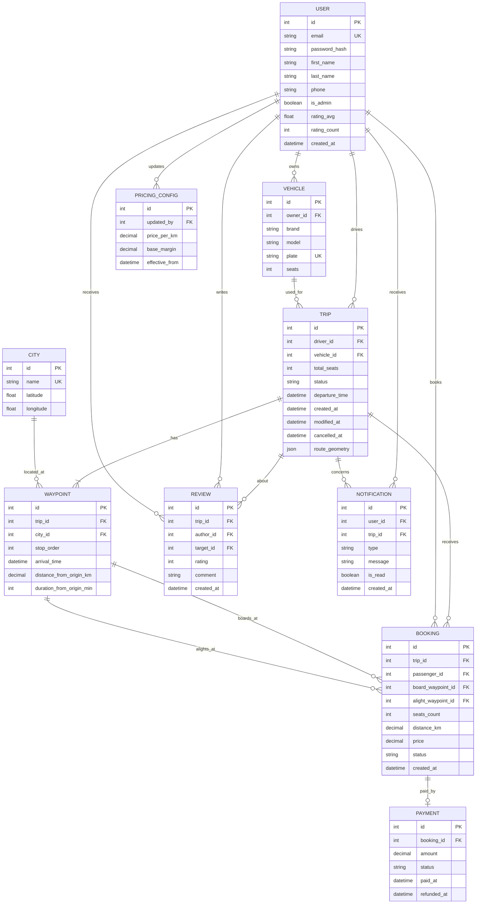

# Data Model (ERD)

## Mermaid Diagram

---

## Entities & Fields

### USER
Base user for passengers, drivers, and admins.
- `id` (PK, int): Unique identifier.
- `email` (UK, string): Login email.
- `password_hash` (string): Hashed password.
- `first_name` (string)
- `last_name` (string)
- `phone` (string, nullable)
- `is_admin` (boolean): Flag for admin dashboard access.
- `rating_avg` (float): Current average rating (starts at 4.0).
- `rating_count` (int): Total number of ratings (starts with 10 seed ratings).
- `created_at` (datetime)

### VEHICLE
Cars owned by drivers.
- `id` (PK, int)
- `owner_id` (FK -> USER)
- `brand` (string)
- `model` (string)
- `plate` (UK, string): Registration plate number.
- `seats` (int): Total seat capacity including driver.

### CITY
Moroccan cities serving as trip origins, stops, and destinations.
- `id` (PK, int)
- `name` (UK, string)
- `latitude` (float)
- `longitude` (float)

### TRIP
A ride planned and offered by a driver.
- `id` (PK, int)
- `driver_id` (FK -> USER)
- `vehicle_id` (FK -> VEHICLE)
- `total_seats` (int): Seats available for passengers.
- `status` (string): `scheduled`, `active`, `completed`, `cancelled`.
- `departure_time` (datetime)
- `created_at` (datetime)
- `modified_at` (datetime, nullable)
- `cancelled_at` (datetime, nullable)
- `route_geometry` (json, nullable): GeoJSON LineString for map polyline.

### WAYPOINT
An ordered stop on a trip route (origin, intermediate stop, or destination).
- `id` (PK, int)
- `trip_id` (FK -> TRIP)
- `city_id` (FK -> CITY)
- `stop_order` (int): Order of the stop in the journey (0 = origin).
- `arrival_time` (datetime)
- `distance_from_origin_km` (decimal): Cumulative km from origin.
- `duration_from_origin_min` (int, nullable): Cumulative driving minutes from origin.

### BOOKING
A passenger's seat reservation between two waypoints.
- `id` (PK, int)
- `trip_id` (FK -> TRIP)
- `passenger_id` (FK -> USER)
- `board_waypoint_id` (FK -> WAYPOINT): Boarding stop.
- `alight_waypoint_id` (FK -> WAYPOINT): Drop-off stop.
- `seats_count` (int): Number of seats booked.
- `distance_km` (decimal): Segment distance (alight km - board km).
- `price` (decimal): Total price calculated from segment distance and driver rating.
- `status` (string): `confirmed`, `pending_confirmation`, `cancelled_by_passenger`, `cancelled_by_driver`, `completed`.
- `created_at` (datetime)

### PAYMENT
Financial record attached to a booking.
- `id` (PK, int)
- `booking_id` (FK -> BOOKING, unique)
- `amount` (decimal)
- `status` (string): `completed`, `refunded`, `pending`.
- `paid_at` (datetime)
- `refunded_at` (datetime, nullable)

### REVIEW
Two-way rating and feedback between driver and passenger after trip completion.
- `id` (PK, int)
- `trip_id` (FK -> TRIP)
- `author_id` (FK -> USER): Author of review.
- `target_id` (FK -> USER): User being reviewed.
- `rating` (int): 1 to 5 stars.
- `comment` (text, nullable)
- `created_at` (datetime)

### NOTIFICATION
In-app alert for schedule modifications, cancellations, refunds, or bookings.
- `id` (PK, int)
- `user_id` (FK -> USER)
- `trip_id` (FK -> TRIP, nullable)
- `type` (string): `trip_modified`, `trip_cancelled`, `booking_confirmed`, `refund_issued`, etc.
- `message` (text)
- `is_read` (boolean)
- `created_at` (datetime)

### PRICING_CONFIG
Global pricing rules set by administrators.
- `id` (PK, int)
- `updated_by` (FK -> USER, nullable)
- `price_per_km` (decimal): Base rate (e.g., 1.50 DH/km).
- `base_margin` (decimal): Base platform margin (e.g., 0.05 for 5%).
- `effective_from` (datetime)

---

## Core Relationships

- **USER & VEHICLE**: A user owns 0 or many vehicles (1:N).
- **USER & TRIP**: A user drives 0 or many trips (1:N).
- **TRIP & WAYPOINT**: A trip has 2 or more waypoints ordered by `stop_order` (1:N).
- **CITY & WAYPOINT**: A city is referenced by waypoints across trips (1:N).
- **TRIP & BOOKING**: A trip receives bookings across its segments (1:N).
- **BOOKING & WAYPOINT**: A booking links a specific `board_waypoint` and `alight_waypoint` (N:1).
- **BOOKING & PAYMENT**: Each booking has exactly one payment record (1:1).
- **TRIP, USER & REVIEW**: Authors and targets leave reviews linked to a completed trip (N:1).
- **USER & NOTIFICATION**: A user receives targeted alerts (1:N).
- **PRICING_CONFIG**: Managed by admin users to drive segment calculations (N:1).
